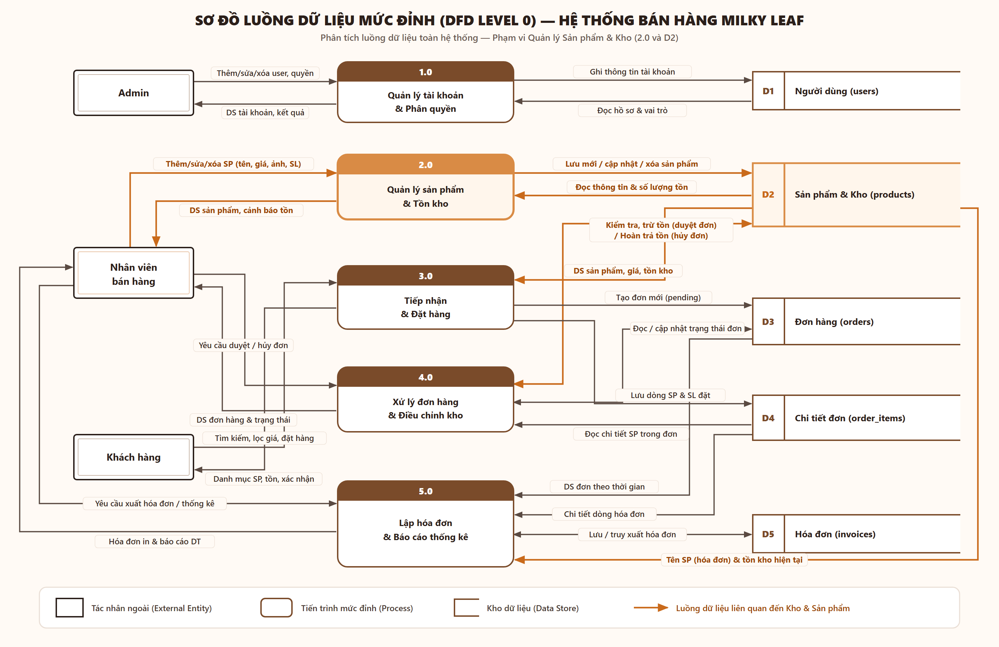
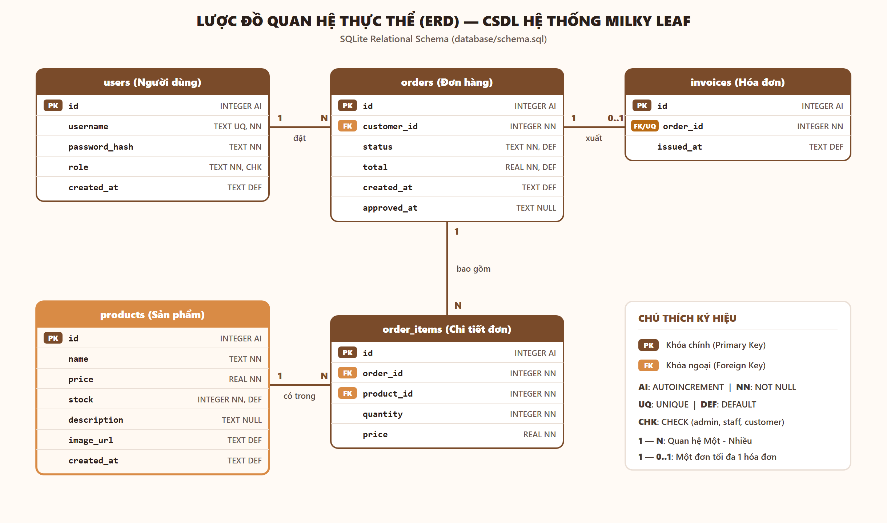

# PHẦN BÁO CÁO CỦA THÀNH VIÊN 2 — THIẾT KẾ CSDL & DFD KHO / SẢN PHẨM

> **Hệ thống:** Website Quản lý & Bán hàng Trà sữa **Milky Leaf**  
> **Phụ trách:** Thành viên 2 (TV2)  
> **Phạm vi báo cáo:**
> 1. Sơ đồ luồng dữ liệu mức đỉnh (DFD Level 0) liên quan đến Kho và Sản phẩm *(thuộc Mục 1.2)*.
> 2. Thiết kế Cơ sở dữ liệu — Lược đồ ERD / Lược đồ quan hệ & Từ điển dữ liệu *(Mục 2.1)*.

---

## 1. Sơ đồ luồng dữ liệu mức đỉnh (DFD Level 0) — Trọng tâm Kho & Sản phẩm

### 1.1. Hình ảnh sơ đồ

*(File nguồn chỉnh sửa được đặt tại: [DFD_Muc_Dinh_Kho_San_Pham.drawio](DFD_So_do/DFD_Muc_Dinh_Kho_San_Pham.drawio))*

### 1.2. Mô tả các thành phần trong DFD mức đỉnh

#### a) Tác nhân ngoài (External Entities)
- **Admin:** Quản trị hệ thống, quản lý tài khoản và phân quyền người dùng.
- **Nhân viên bán hàng:** Tác nhân chính thao tác trực tiếp trên phân hệ sản phẩm & kho (thêm, sửa, xóa sản phẩm, cập nhật giá bán, hình ảnh, tồn kho ban đầu), đồng thời xử lý duyệt/hủy đơn và xuất hóa đơn/báo cáo.
- **Khách hàng:** Người dùng tìm kiếm, lọc sản phẩm theo tên/giá, xem số lượng tồn và thực hiện đặt hàng.

#### b) Các tiến trình mức đỉnh (Level 0 Processes)
- **1.0 Quản lý tài khoản & Phân quyền:** Tiếp nhận yêu cầu CRUD tài khoản và phân vai trò (`admin`, `staff`, `customer`) từ Admin, lưu/đọc trên kho `D1`.
- **2.0 Quản lý sản phẩm & Tồn kho:** Tiếp nhận dữ liệu sản phẩm từ Nhân viên bán hàng (tên sản phẩm, giá bán, hình ảnh, số lượng tồn kho, mô tả); kiểm tra tính hợp lệ; thực hiện thêm mới, cập nhật hoặc xóa bản ghi trong kho `D2`; trả về danh sách sản phẩm và cảnh báo sắp hết hàng (`stock <= 20`).
- **3.0 Tiếp nhận & Đặt hàng:** Đọc thông tin sản phẩm, giá bán và tồn kho hiện tại từ `D2` để hiển thị cho Khách hàng; ghi nhận đơn hàng mới ở trạng thái `pending` vào `D3` và chi tiết từng mặt hàng vào `D4`.
- **4.0 Xử lý đơn hàng & Điều chỉnh kho:** Khi Nhân viên bán hàng duyệt đơn, kiểm tra và trừ số lượng tồn kho tương ứng trong `D2`; khi hủy đơn đã duyệt, cộng hoàn trả số lượng sản phẩm vào `D2`; đồng thời cập nhật trạng thái đơn hàng trong `D3`.
- **5.0 Lập hóa đơn & Báo cáo thống kê:** Đọc dữ liệu đơn hàng (`D3`), chi tiết đơn (`D4`), tên và tồn kho sản phẩm (`D2`) để lập và lưu hóa đơn vào `D5`, cũng như tổng hợp doanh thu và thống kê cho Nhân viên bán hàng.

#### c) Kho dữ liệu (Data Stores)
- **D1 — Người dùng (`users`):** Lưu thông tin tài khoản, mật khẩu băm và vai trò phân quyền.
- **D2 — Sản phẩm & Kho (`products`):** Lưu danh mục sản phẩm, giá bán, hình ảnh, mô tả và số lượng tồn kho hiện tại.
- **D3 — Đơn hàng (`orders`):** Lưu thông tin chung của đơn đặt hàng, trạng thái và tổng tiền.
- **D4 — Chi tiết đơn hàng (`order_items`):** Lưu danh sách sản phẩm, số lượng và đơn giá tại thời điểm đặt hàng của từng đơn.
- **D5 — Hóa đơn (`invoices`):** Lưu thông tin chứng từ hóa đơn đã xuất cho từng đơn hàng.

#### d) Bảng tổng hợp các luồng dữ liệu chính liên quan đến Kho & Sản phẩm
| STT | Nguồn | Đích | Tên luồng dữ liệu | Ý nghĩa nghiệp vụ |
| :-: | :--- | :--- | :--- | :--- |
| 1 | Nhân viên bán hàng | `2.0` | Thêm/sửa/xóa SP (tên, giá, ảnh, SL) | Nhân viên nhập mới hoặc chỉnh sửa thông tin sản phẩm, tồn kho |
| 2 | `2.0` | Nhân viên bán hàng | DS sản phẩm, cảnh báo tồn | Hiển thị danh sách mặt hàng, tồn kho và trạng thái hết/sắp hết |
| 3 | `2.0` | `D2 (products)` | Lưu mới / cập nhật / xóa sản phẩm | Ghi nhận thay đổi danh mục sản phẩm và số lượng tồn vào CSDL |
| 4 | `D2 (products)` | `2.0` | Đọc thông tin & số lượng tồn | Truy xuất danh sách sản phẩm, lọc/tìm kiếm và tính KPI kho |
| 5 | `D2 (products)` | `3.0` | DS sản phẩm, giá, tồn kho | Cung cấp mặt hàng và số lượng còn lại cho Khách hàng xem và đặt |
| 6 | `4.0` ↔ `D2 (products)` | `D2` / `4.0` | Trừ tồn (duyệt đơn) / Hoàn trả tồn (hủy đơn) | Đồng bộ biến động kho tự động theo trạng thái duyệt/hủy đơn |
| 7 | `D2 (products)` | `5.0` | Tên SP (hóa đơn) & tồn kho hiện tại | Cung cấp tên sản phẩm khi in hóa đơn và thống kê mặt hàng |

---

## 2. Thiết kế Cơ sở dữ liệu (Mục 2.1)

Hệ thống sử dụng hệ quản trị CSDL quan hệ nhẹ **SQLite** (`database.db`), được khởi tạo thông qua script [schema.sql](../database/schema.sql), hàm kết nối & migration [db_helper.py](../database/db_helper.py) và dữ liệu mẫu [seed_data.sql](../database/seed_data.sql).

### 2.1. Lược đồ quan hệ thực thể (ERD) & Lược đồ quan hệ

*(File nguồn chỉnh sửa được đặt tại: [ERD_CSDL_MilkyLeaf.drawio](DFD_So_do/ERD_CSDL_MilkyLeaf.drawio))*

**Lược đồ quan hệ (Relational Schema):**
- `users` (**`id`**, `username`, `password_hash`, `role`, `created_at`)
- `products` (**`id`**, `name`, `price`, `stock`, `description`, `image_url`, `created_at`)
- `orders` (**`id`**, *`customer_id`*, `status`, `total`, `created_at`, `approved_at`)
- `order_items` (**`id`**, *`order_id`*, *`product_id`*, `quantity`, `price`)
- `invoices` (**`id`**, *`order_id`*, `issued_at`)

**Mô tả các mối quan hệ giữa các bảng:**
1. **`users` (1) — (N) `orders`:** Một khách hàng (`users.id`) có thể đặt nhiều đơn hàng (`orders.customer_id`).
2. **`orders` (1) — (N) `order_items`:** Một đơn hàng (`orders.id`) bao gồm nhiều dòng chi tiết sản phẩm (`order_items.order_id`).
3. **`products` (1) — (N) `order_items`:** Một sản phẩm (`products.id`) có thể xuất hiện trong nhiều chi tiết đơn hàng (`order_items.product_id`).
4. **`orders` (1) — (0..1) `invoices`:** Một đơn hàng (`orders.id`) khi xuất chứng từ sẽ tương ứng với tối đa một hóa đơn duy nhất (`invoices.order_id` có ràng buộc `UNIQUE`).

---

### 2.2. Từ điển dữ liệu (Data Dictionary)

#### Bảng 1: `users` — Lưu thông tin tài khoản và phân quyền người dùng
| STT | Tên thuộc tính | Kiểu dữ liệu | Khóa / Ràng buộc | Giá trị mặc định | Mô tả |
| :-: | :--- | :--- | :--- | :--- | :--- |
| 1 | `id` | `INTEGER` | `PRIMARY KEY AUTOINCREMENT` | Tự tăng | Mã định danh duy nhất của người dùng |
| 2 | `username` | `TEXT` | `UNIQUE, NOT NULL` | — | Tên đăng nhập, không được trùng lặp |
| 3 | `password_hash` | `TEXT` | `NOT NULL` | — | Mật khẩu đã được mã hóa băm (Werkzeug hash) |
| 4 | `role` | `TEXT` | `NOT NULL, CHECK (role IN ('admin', 'staff', 'customer'))` | — | Vai trò người dùng: `admin`, `staff`, hoặc `customer` |
| 5 | `created_at` | `TEXT` | — | `CURRENT_TIMESTAMP` | Ngày giờ khởi tạo tài khoản |

#### Bảng 2: `products` — Lưu thông tin sản phẩm và tồn kho
| STT | Tên thuộc tính | Kiểu dữ liệu | Khóa / Ràng buộc | Giá trị mặc định | Mô tả |
| :-: | :--- | :--- | :--- | :--- | :--- |
| 1 | `id` | `INTEGER` | `PRIMARY KEY AUTOINCREMENT` | Tự tăng | Mã định danh duy nhất của sản phẩm |
| 2 | `name` | `TEXT` | `NOT NULL` | — | Tên đồ uống / sản phẩm (tối đa 150 ký tự ở tầng nghiệp vụ) |
| 3 | `price` | `REAL` | `NOT NULL, CHECK (price >= 0)` | — | Đơn giá bán hiện hành (VNĐ, giá trị không âm) |
| 4 | `stock` | `INTEGER` | `NOT NULL` | `0` | Số lượng tồn kho hiện có (số nguyên không âm) |
| 5 | `description` | `TEXT` | `NULL` | — | Mô tả chi tiết về hương vị, thành phần sản phẩm |
| 6 | `image_url` | `TEXT` | — | `''` | Đường dẫn nội bộ (`/static/images/products/...`) hoặc URL ảnh sản phẩm |
| 7 | `created_at` | `TEXT` | — | `CURRENT_TIMESTAMP` | Ngày giờ thêm sản phẩm vào hệ thống |

#### Bảng 3: `orders` — Lưu thông tin đơn đặt hàng
| STT | Tên thuộc tính | Kiểu dữ liệu | Khóa / Ràng buộc | Giá trị mặc định | Mô tả |
| :-: | :--- | :--- | :--- | :--- | :--- |
| 1 | `id` | `INTEGER` | `PRIMARY KEY AUTOINCREMENT` | Tự tăng | Mã định danh duy nhất của đơn hàng |
| 2 | `customer_id` | `INTEGER` | `NOT NULL, FK → users(id)` | — | Mã khách hàng thực hiện đặt đơn |
| 3 | `status` | `TEXT` | `NOT NULL` | `'pending'` | Trạng thái đơn: `pending` (Chờ duyệt), `approved` (Đã duyệt), `cancelled` (Đã hủy) |
| 4 | `total` | `REAL` | `NOT NULL` | `0` | Tổng tiền thanh toán của đơn hàng (VNĐ) |
| 5 | `created_at` | `TEXT` | — | `CURRENT_TIMESTAMP` | Thời điểm tạo đơn hàng |
| 6 | `approved_at` | `TEXT` | `NULL` | `NULL` | Thời điểm nhân viên duyệt đơn (`NULL` nếu chưa duyệt) |

#### Bảng 4: `order_items` — Lưu chi tiết các sản phẩm trong từng đơn hàng
| STT | Tên thuộc tính | Kiểu dữ liệu | Khóa / Ràng buộc | Giá trị mặc định | Mô tả |
| :-: | :--- | :--- | :--- | :--- | :--- |
| 1 | `id` | `INTEGER` | `PRIMARY KEY AUTOINCREMENT` | Tự tăng | Mã dòng chi tiết đơn hàng |
| 2 | `order_id` | `INTEGER` | `NOT NULL, FK → orders(id)` | — | Mã đơn hàng chứa mặt hàng này |
| 3 | `product_id` | `INTEGER` | `NOT NULL, FK → products(id)` | — | Mã sản phẩm được đặt mua |
| 4 | `quantity` | `INTEGER` | `NOT NULL` | — | Số lượng sản phẩm đặt mua |
| 5 | `price` | `REAL` | `NOT NULL` | — | Đơn giá sản phẩm tại thời điểm đặt hàng |

#### Bảng 5: `invoices` — Lưu trữ hóa đơn bán hàng đã xuất
| STT | Tên thuộc tính | Kiểu dữ liệu | Khóa / Ràng buộc | Giá trị mặc định | Mô tả |
| :-: | :--- | :--- | :--- | :--- | :--- |
| 1 | `id` | `INTEGER` | `PRIMARY KEY AUTOINCREMENT` | Tự tăng | Mã hóa đơn bán hàng (`HD{id}`) |
| 2 | `order_id` | `INTEGER` | `UNIQUE, NOT NULL, FK → orders(id)` | — | Mã đơn hàng liên kết (mỗi đơn tối đa 1 hóa đơn) |
| 3 | `issued_at` | `TEXT` | — | `CURRENT_TIMESTAMP` | Thời điểm xuất và lưu hóa đơn |

---

### 2.3. Dữ liệu mẫu (Dummy Data) phục vụ Demo
Script [seed_data.sql](../database/seed_data.sql) (chạy được độc lập sau [schema.sql](../database/schema.sql) hoặc tự động qua `init_db()` trong [db_helper.py](../database/db_helper.py)) khởi tạo sẵn bộ dữ liệu demo gồm:
- **5 tài khoản người dùng:** `admin` (`admin123`), `staff` (`staff123`), `customer` (`customer123`), `kh_minh`, `kh_tuan`.
- **8 sản phẩm đồ uống có đầy đủ hình ảnh SVG cục bộ:** Trà sữa truyền thống, Trà đào cam sả, Sữa tươi trân châu đường đen, Trà xanh sữa, Cà phê sữa đá, Trà sữa matcha, Trà sữa khoai môn (tồn kho thấp `15` để demo cảnh báo sắp hết), Trà ô long kem cheese.
- **6 đơn hàng mẫu** (`pending`, `approved`, `cancelled`), **12 dòng `order_items`** khớp tổng tiền và **1 hóa đơn mẫu** (`id = 1`, `order_id = 200000015`) để demo ngay nghiệp vụ duyệt/hủy đơn, trừ/hoàn kho, in và lưu hóa đơn.
